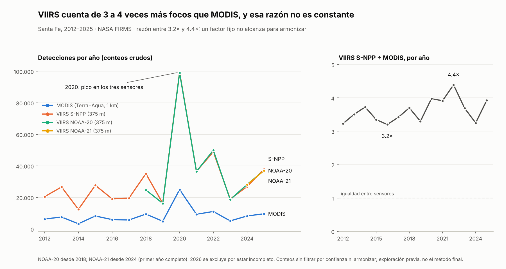

# Calendario de actividad de quemas armonizado — Santa Fe, Argentina

**Armonización de detecciones de focos de calor MODIS y VIIRS para comparar 14 años de actividad de quemas sin el sesgo del cambio de sensor.**

| | |
|---|---|
| **Evento** | NASA Space Apps Challenge 2026 · Sede Rosario, Argentina |
| **Desafío** | *Harmonization of MODIS and VIIRS Hot Spots* |
| **Área** | Provincia de Santa Fe (≈ 133.000 km²) |
| **Período** | 2012-01-01 a 2026-10-01 |
| **Datos** | NASA FIRMS — MODIS C6.1, VIIRS 375 m (S-NPP, NOAA-20, NOAA-21) |
| **Estado** | Preparación: datos descargados y explorados. La solución se desarrolla durante el evento (14–15/11/2026). |

> **English summary.** NASA's active-fire record for the last two decades is split between MODIS (1 km)
> and VIIRS (375 m). Over Santa Fe province, raw VIIRS counts are 3.2–4.4 times higher than MODIS
> counts every year, so a naïve merged series shows burning "growing" only because the instrument
> changed. This project will calibrate VIIRS against MODIS-Aqua on matched observations, validate the
> correction on held-out years, and deliver a harmonized burning-activity calendar with visible
> uncertainty, aimed at seasonal and regional planning.

---

## Contenido

1. [Problema](#1-problema)
2. [Evidencia preliminar](#2-evidencia-preliminar)
3. [Hipótesis y método propuesto](#3-hipótesis-y-método-propuesto)
4. [Datos](#4-datos)
5. [Resultado esperado](#5-resultado-esperado)
6. [Limitaciones](#6-limitaciones)
7. [Uso previsto](#7-uso-previsto)
8. [Trabajo futuro](#8-trabajo-futuro)
9. [Reproducibilidad](#9-reproducibilidad)
10. [Uso de inteligencia artificial](#10-uso-de-inteligencia-artificial)
11. [Referencias](#11-referencias)
12. [Créditos y licencia](#12-créditos-y-licencia)

---

## 1. Problema

Los satélites detectan focos de calor activos (incendios y quemas) desde el año 2000. El registro, sin
embargo, está repartido entre dos generaciones de instrumentos:

| Instrumento | Satélites | Resolución | Disponible desde |
|---|---|---|---|
| MODIS | Terra, Aqua | 1 km | 2000 |
| VIIRS | S-NPP, NOAA-20, NOAA-21 | 375 m | 2012 |

VIIRS ve focos más pequeños y separa focos cercanos que MODIS registra como uno solo. Si ambos registros
se unen sin corrección, la actividad de quemas **parece aumentar por el solo hecho de cambiar de
instrumento**.

El problema es cada vez más relevante: las misiones Terra y Aqua se acercan al final de su vida útil,
y S-NPP dejó de entregar datos nuevos el 2 de noviembre de 2026. La continuidad del registro depende de
NOAA-20 y NOAA-21. Sin un puente entre ambos instrumentos, las detecciones futuras no podrán compararse
con dos décadas de historia.

## 2. Evidencia preliminar

Exploración realizada antes del evento sobre los datos descargados: conteo anual de detecciones por
sensor, sin filtros de confianza ni armonización.

| Año | MODIS | VIIRS S-NPP | VIIRS NOAA-20 | VIIRS NOAA-21 | S-NPP ÷ MODIS |
|---|---:|---:|---:|---:|---:|
| 2012 | 6.361 | 20.554 | — | — | 3,23 |
| 2016 | 5.972 | 19.124 | — | — | 3,20 |
| 2020 | 24.997 | 99.456 | 99.029 | — | 3,98 |
| 2022 | 11.136 | 48.907 | 49.945 | — | 4,39 |
| 2024 | 8.271 | 26.888 | 28.259 | 28.060 | 3,25 |
| 2025 | 9.664 | 37.940 | 37.046 | 36.996 | 3,93 |

*Selección de años. NOAA-20 comienza en 2018 y NOAA-21 se muestra desde 2024, su primer año completo.*

**Qué indica:**

- VIIRS registra entre **3,2 y 4,4 veces** más detecciones que MODIS todos los años.
- Los satélites VIIRS coinciden entre sí: en los años completos que comparten (2019–2025) las
  diferencias son de alrededor del 5 % o menos, lo que descarta una anomalía de un satélite en particular.
- Los picos (por ejemplo, 2020) aparecen en todos los sensores: miden la misma actividad, con distinta
  sensibilidad.
- La razón entre sensores **no es constante**, por lo que un factor fijo no alcanza para armonizar.

**Qué no indica todavía:** estos conteos no controlan nubosidad, horario de paso, cantidad de pasadas
ni coincidencia espacial. La diferencia observada combina resolución, número de observaciones y
condiciones de observación. Por eso se presenta como **evidencia preliminar**: motiva el método, no lo
reemplaza. La literatura reporta el mismo sesgo en zonas con fuegos pequeños o de baja intensidad
[3] y atribuye parte de la diferencia a la mayor cantidad de pasadas de VIIRS [4].

## 3. Hipótesis y método propuesto

**Hipótesis.** Comparando observaciones coincidentes en tiempo y espacio, es posible estimar una
relación VIIRS→MODIS que permita construir una serie continua 2012–2026, con un margen de
incertidumbre cuantificado.

**Método** (se implementa durante el evento):

| Paso | Descripción | Control de calidad |
|---|---|---|
| 1. Preparación | Unir datos estándar y NRT por sensor; filtrar por confianza (MODIS ≥ 30; VIIRS nominal y alta) y tipo de foco; agregar por celda de 0,1° y día. | Conteos antes/después de cada filtro |
| 2. Calibración | Estimar la razón VIIRS / MODIS-Aqua por mes, solo en celdas-día observadas por ambos. Aqua y VIIRS pasan cerca de las 13:30, lo que reduce el efecto horario. | Intervalo de confianza por *bootstrap* |
| 3. Validación | Calibrar con 2012–2020 y evaluar con 2021–2026, datos que el modelo no vio. | Error de la serie corregida frente a MODIS |
| 4. Calendario | Actividad semanal por zona, línea base (mediana y percentil 90) y semanas atípicas. | Incertidumbre visible en cada celda |
| 5. Aplicación | Aplicación web para elegir zona y consultar el calendario. | Limitaciones visibles en la interfaz |

## 4. Datos

Fuente: **NASA FIRMS**, descarga de archivo con polígono de la provincia de Santa Fe.

| Sensor | Producto en FIRMS | Datos estándar | Datos NRT |
|---|---|---|---|
| MODIS Terra + Aqua | MODIS C6.1 | ene 2012 – ago 2026 | sep 2026 |
| VIIRS S-NPP | SUOMI VIIRS C2 | ene 2012 – jul 2026 | ago – sep 2026 |
| VIIRS NOAA-20 | J1 VIIRS C2 | abr 2018 – jul 2026 | ago – sep 2026 |
| VIIRS NOAA-21 | J2 VIIRS C2 | mar 2023 – jul 2026 | ago – oct 2026 |

Detalle de columnas, polígono y forma de reproducir la descarga: [`docs/datos.md`](docs/datos.md).
Los datos no se incluyen en el repositorio.

## 5. Resultado esperado

- Serie histórica armonizada de actividad de quemas 2012–2026 para Santa Fe y sus zonas.
- Calendario semanal que muestre la temporada típica, los períodos críticos y las semanas atípicas.
- Aplicación web de consulta, con la incertidumbre y las limitaciones a la vista.
- Código y método documentados para reproducir el análisis en otra región.

## 6. Limitaciones

- **La ausencia de observación no equivale a ausencia de fuego.** Nubes y huecos de datos no son ceros.
- **Los valores armonizados son estimaciones** con margen de incertidumbre, no mediciones directas.
- **Los datos NRT de los meses recientes** son reemplazados luego por datos estándar y pueden cambiar.
- **Resolución espacial:** NASA indica que estos datos no son recomendables para decisiones tácticas ni
  a escala local. La herramienta apunta a la planificación estacional y regional, no a alertas por
  parcela.
- **Área:** el polígono aproxima la provincia; la cobertura del Delta del Paraná del lado entrerriano no
  está garantizada.
- **Detección ≠ causa:** un foco de calor no indica quién originó el fuego ni por qué.

## 7. Uso previsto

Apoyo a la planificación estacional (cosecha, logística y transporte) y a la comparación objetiva entre
temporadas en zonas agroindustriales de la región. *Este uso es una hipótesis pendiente de validación
con actores del sector; no constituye un requerimiento confirmado.*

## 8. Trabajo futuro

- Validar la corrección contra el producto **VIIRS 750 m (VNP14)**, diseñado para dar continuidad al
  registro MODIS de 1 km [2].
- Actualización periódica automática y aviso de semanas por encima de lo habitual.
- Indicadores de condiciones de riesgo combinando focos con variables meteorológicas.

## 9. Reproducibilidad

1. Descargar los cuatro productos desde FIRMS con los parámetros de [`docs/datos.md`](docs/datos.md).
2. Descomprimir cada archivo en `datos/modis`, `datos/viirs_snpp`, `datos/viirs_noaa20` y
   `datos/viirs_noaa21`.
3. Entorno: Python 3.13 con pandas, pyarrow, plotly y streamlit.
4. Instrucciones de ejecución: *se completan con el código durante el evento.*

## 10. Uso de inteligencia artificial

Durante la preparación se utilizó un asistente de IA (Claude, de Anthropic) para organizar el plan de
trabajo, redactar la documentación y realizar la exploración preliminar de los datos. Las decisiones
de alcance, la descarga de datos y la revisión del contenido corresponden al autor. La declaración
completa, incluido el uso durante el evento, se publica al cierre de la entrega.

## 11. Referencias

1. NASA FIRMS — Archive Download. <https://firms.modaps.eosdis.nasa.gov/download/>
2. NASA VIIRS Land — Active Fire Product (VNP14 / VNP14IMG).
   <https://viirsland.gsfc.nasa.gov/Products/NASA/FireESDR.html>
3. Schroeder, W. (2017). *VIIRS Data Resources*. GOFC-GOLD Fire Implementation Team meeting.
   <https://gofcgold.umd.edu/sites/default/files/fireit_meetings/GOFC_Fire_IT_2017/day1/Schroeder.pdf>
4. Campus, A.; Laiolo, M.; Massimetti, F.; Coppola, D. (2022). The Transition from MODIS to VIIRS for
   Global Volcano Thermal Monitoring. *Sensors*, 22(5), 1713. <https://doi.org/10.3390/s22051713>
5. Política de uso de datos de Earthdata.
   <https://www.earthdata.nasa.gov/engage/open-data-services-software-policies/data-use-policy>

Los datos de FIRMS se citan según el `Readme.txt` incluido en cada descarga.

## 12. Créditos y licencia

**Autor:** Emanuel Pereyra.
**Datos:** NASA FIRMS / LANCE (NASA ESDIS).
**Código:** licencia MIT ([`LICENSE`](LICENSE)). Los datos de NASA se rigen por su propia política de uso.
**Cita:** [`CITATION.cff`](CITATION.cff) · **Seguridad:** [`SECURITY.md`](SECURITY.md)
